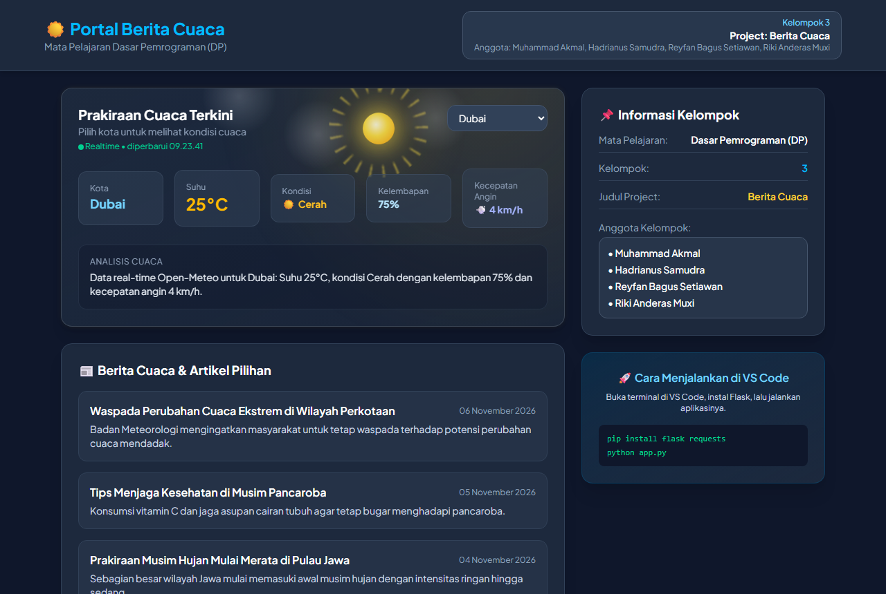
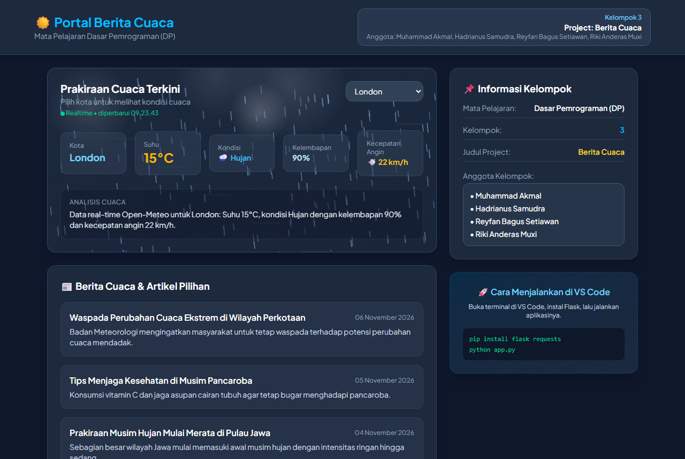
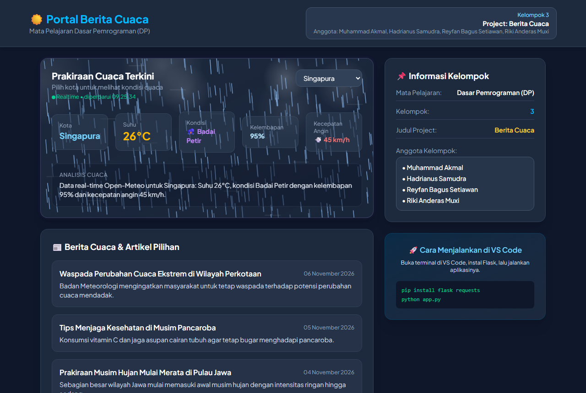

# Berita Cuaca — Kelompok 3

Aplikasi web prakiraan cuaca **real-time** untuk tugas mata pelajaran **Dasar Pemrograman (DP)**.
Dibuat dengan Python (Flask) dan menampilkan data cuaca langsung dari Open-Meteo API.

## Fitur

- Prakiraan cuaca real-time (suhu, kondisi, kelembapan, kecepatan angin)
- 19 kota: 7 kota Indonesia + 12 kota luar negeri
- Data diperbarui otomatis tiap 30 detik tanpa reload halaman (AJAX polling)
- Efek animasi cuaca:
  - Matahari dengan sinar berputar saat cerah
  - Hujan/gerimis dengan intensitas berbeda
  - Badai petir dengan kilatan
  - Kabut dan awan melayang
- Warna tema kartu berubah sesuai kondisi cuaca
- Pilihan kota tersimpan di URL (`?city=Tokyo`), aman saat refresh

## Tampilan Aplikasi

| Cuaca Cerah | Hujan | Badai Petir |
|:---:|:---:|:---:|
|  |  |  |

## Teknologi

- Python 3 + Flask
- Open-Meteo API (gratis, tanpa API key)
- Tailwind CSS (CDN) + JavaScript Canvas

## Cara Menjalankan

```bash
pip install flask requests
python app.py
```

Buka browser ke <http://127.0.0.1:5000>

## Struktur

```
berita-cuaca/
├── app.py                     # seluruh aplikasi (Python + HTML/CSS/JS)
├── requirements.txt
├── README.md
├── .gitignore
└── docs/
    └── screenshots/           # gambar tampilan aplikasi
        ├── cerah.png
        ├── hujan.png
        └── badai.png
```

## API

| Endpoint | Keterangan |
|---|---|
| `GET /` | Halaman utama |
| `GET /?city=NamaKota` | Halaman dengan kota tertentu |
| `GET /api/weather?city=NamaKota` | Data cuaca dalam format JSON |

## Anggota Kelompok 3

1. Muhammad Akmal
2. Hadrianus Samudra
3. Reyfan Bagus Setiawan
4. Riki Anderas Muxi
